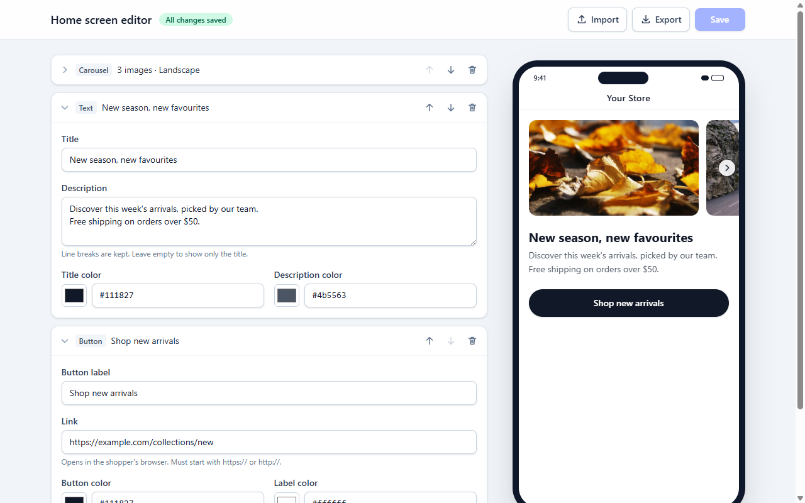
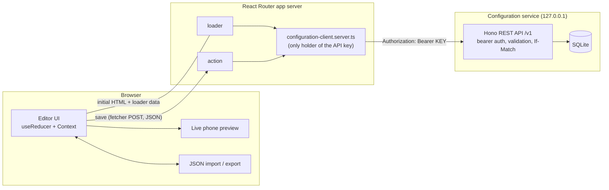

# Mobile App Home Screen Editor

A full-stack editor for a mobile app's home screen. Merchants add, edit, reorder and remove
carousel, text and call-to-action sections and see a live phone preview as they type. Saving goes
through the app's server, which calls a separate, privately authenticated configuration service.
Reloading the page restores the saved screen.

- **Stack:** React Router 7 (framework mode, SSR), React 19, TypeScript, Tailwind CSS 4, Zod 4,
  Hono (configuration service), SQLite via Node's built-in `node:sqlite`, Vitest + Testing Library.
- **Decision log:** [`DECISION_LOG.md`](./DECISION_LOG.md) (how AI was used, what was changed or
  rejected, tradeoffs, next steps).



## Quick start

Requires **Node.js 22.22.2+ or 24.15+** (developed on Node 24.18, npm 11). Nothing else: no
database server or Docker.

```bash
npm install
npm run dev
```

Open http://localhost:5173.

npm 11 may warn that it skipped `esbuild`'s install script ("allow-scripts"). That script only
verifies the platform binary, which npm installs anyway, so the warning can be ignored.

`npm run dev` first runs `npm run setup`, which creates `.env` from `.env.example` with a freshly
generated random API key (an existing `.env` is never modified). It then starts both processes:

| Process | URL | Notes |
| --- | --- | --- |
| Configuration service | http://127.0.0.1:4000 | Private REST API; bound to loopback only; needs the API key |
| Editor (React Router app) | http://localhost:5173 | The only thing the browser talks to |

### Other commands

| Command | What it does |
| --- | --- |
| `npm test` | Runs all 126 tests (Node and jsdom projects) |
| `npm run typecheck` | Generates React Router route types, then runs `tsc` |
| `npm run build` | Production build of the editor |
| `npm start` | Runs the built editor (http://localhost:3000) and the service together. Run `npm run build` first; it needs `.env` (run `npm run setup` if you skipped `npm run dev`) |
| `npm run setup` | Creates `.env` with a random key if it does not exist |

## Environment variables

All variables are server-side. None use the `VITE_` prefix, so none can be inlined into browser
code. Both processes read `.env` themselves; real environment variables take precedence.

| Variable | Used by | Required | Default | Purpose |
| --- | --- | --- | --- | --- |
| `CONFIG_SERVICE_API_KEY` | service + app server | **Yes** (min. 32 chars) | none | Shared secret. The app server sends it as `Authorization: Bearer <key>`; the service rejects anything else. No fallback: both processes refuse to start or serve without it. |
| `CONFIG_SERVICE_URL` | app server | No | `http://127.0.0.1:4000` | Where the app server reaches the service |
| `CONFIG_SERVICE_PORT` | service | No | `4000` | Service port (always bound to `127.0.0.1`) |
| `CONFIG_DB_PATH` | service | No | `./data/configurations.sqlite` | SQLite file, created on first start |
| `PORT` | `npm start` (web) | No | `3000` | Port for the production editor server |

## Architecture



- **The browser never calls the configuration service.** It talks only to the editor's own
  routes: the server `loader` for the initial load, and the server `action` (via `useFetcher`)
  for saves. The key lives in `.server.ts` modules, which React Router refuses to bundle for the
  browser. A scan of the production client bundle for the key value, the variable name, the
  service URL and `Bearer` finds no matches.
- **One shared contract.** `contract/` holds the Zod schemas, limits and URL/color rules. The
  same `parseConfigurationDocument()` validates the live draft in the browser, imported files, the
  app server's save action and the service's writes, so the layers cannot disagree.
- **Preview updates are purely local.** Inputs dispatch to a reducer; the preview renders the
  draft. No network request is involved until Save.

### Project layout

```
contract/            Shared by browser, app server and service (no framework or Node imports)
  home-screen.ts     Section/document schemas, schemaVersion parse + migration pipeline
  api.ts             Service resource schema, error envelope, ETag helpers
  rules.ts, limits.ts
service/             Private configuration service (separate process)
  app.ts             Hono routes, auth, error handling
  repository.ts      Storage port + SQLite implementation (compare-and-set update)
  env.ts, main.ts
app/                 React Router app
  routes/editor.tsx  loader, action, clientAction, shouldRevalidate, page + error boundary
  server/            *.server.ts: env, service client, load/save use-cases, bounded body reader
  editor/            Reducer, context, validation mapping, save hook, import/export
  sections/          Per-type editor forms + preview renderers, registry, exhaustive switches
  components/        Toolbar, section list/cards, phone preview, form fields
test/fixtures.ts     A document with two sections of each type, all values distinct
scripts/setup.mjs    Creates .env with a random key
```

### What happens on load and save

1. **Load:** the loader asks the service for configuration `home`. `200` initializes the editor
   with it. `404` shows the default screen labelled "Not saved yet", without creating anything.
   Any other failure (service down, timeout, bad key, unexpected response) renders a "could not
   load" page with a retry button. It deliberately does **not** fall back to defaults, because
   saving those would overwrite real data.
2. **Save:** the browser posts `{ baseRevision, document }` to the action. The action caps the body
   at about 1 MiB, requires `application/json`, re-validates the document, then sends `POST`
   (first save) or `PUT` with `If-Match: "<baseRevision>"`. The configuration id is chosen on the
   server, never taken from the request.
3. **Reconcile:** if nothing was typed while the save was in flight, the editor adopts the saved
   copy. If the user kept typing, their newer draft is kept and still shown as unsaved, and the
   next save is based on the new revision.
4. **Failures keep the draft.** A service outage, validation rejection or unreachable app server
   shows a banner with a retry. A revision conflict (someone saved in another tab) offers
   "Export my version" or "Discard my changes and load the latest".

## Configuration service API (`/v1`)

Every `/v1` route requires `Authorization: Bearer <CONFIG_SERVICE_API_KEY>`. Authentication runs
before any body is read or storage is touched (all three operations are tested with a missing and a
wrong key). `GET /health` is public and returns no data.

| Operation | Request | Success | Errors |
| --- | --- | --- | --- |
| Load by id | `GET /v1/configurations/:id` | `200` configuration, `ETag: "<revision>"` | `401`, `404` |
| Create | `POST /v1/configurations` with `{ "id"?: string, "schemaVersion": 1, "data": {...} }` | `201` configuration, `Location`, `ETag` | `400` malformed JSON, `409` id taken, `413`, `415`, `422` |
| Update | `PUT /v1/configurations/:id` with `{ "schemaVersion": 1, "data": {...} }` and `If-Match: "<revision>"` | `200` configuration, new `ETag` | `400` bad `If-Match`, `404`, `412` stale revision, `422`, `428` missing `If-Match` |

`id` on create is optional: omit it and the service generates a UUID. The editor proposes the fixed
id `home` (see Assumptions). `PUT` never creates, so a mistyped id cannot start a second
configuration.

**Resource:**

```json
{
  "id": "home",
  "schemaVersion": 1,
  "revision": 3,
  "updatedAt": "2026-10-21T18:04:12.000Z",
  "data": {
    "sections": [
      { "id": "hero", "type": "carousel", "settings": { "aspectRatio": "portrait", "images": [{ "id": "hero-1", "url": "https://…", "alt": "Autumn collection" }] } },
      { "id": "intro", "type": "text", "settings": { "title": "Fall arrivals", "description": "Layer up.", "titleColor": "#1a2b3c", "descriptionColor": "#555" } },
      { "id": "shop", "type": "cta", "settings": { "label": "Shop now", "url": "https://shop.example.com", "buttonColor": "#0f766e", "labelColor": "#ffffff" } }
    ]
  }
}
```

**Errors** always use one envelope. Validation issues carry RFC 6901 JSON Pointers into the request
body. Messages never include stack traces, SQL or headers.

```json
{ "error": { "code": "VALIDATION_FAILED", "message": "The configuration has 1 invalid field.",
  "issues": [{ "path": "/data/sections/2/settings/url", "message": "Use a full link starting with https:// or http://" }] } }
```

Codes: `BAD_REQUEST`, `UNAUTHORIZED`, `NOT_FOUND`, `ALREADY_EXISTS`, `REVISION_MISMATCH`,
`PRECONDITION_REQUIRED`, `PAYLOAD_TOO_LARGE`, `UNSUPPORTED_MEDIA_TYPE`, `VALIDATION_FAILED`,
`UNSUPPORTED_SCHEMA_VERSION`, `INTERNAL_ERROR`.

Try it (bash; the key is in `.env`):

```bash
KEY=$(grep CONFIG_SERVICE_API_KEY .env | cut -d= -f2)
curl -i http://127.0.0.1:4000/v1/configurations/home                          # 401
curl -i -H "Authorization: Bearer $KEY" http://127.0.0.1:4000/v1/configurations/home
```

### Versioning and schema evolution

Three version concepts are kept separate:

- **`/v1`** is the HTTP contract. A breaking change to routes or semantics would be served as `/v2`
  next to `/v1`.
- **`schemaVersion`** describes the shape of `data` (and of exported files). Currently `1`.
- **`revision`** counts saves of one configuration and is the concurrency token (`ETag`/`If-Match`).

Every document, whether imported, posted or read from storage, goes through
`parseConfigurationDocument()`. It reads `schemaVersion` first and rejects a newer version with one
clear message ("uses schema version 7; this editor supports up to version 1"), not a pile of field
errors. Older versions would be upgraded one step at a time through the `MIGRATIONS` map in
`contract/home-screen.ts`. Adding v2 means writing the v2 schema, adding a `1 → 2` function to that
map, and bumping `CURRENT_SCHEMA_VERSION`. Stored v1 rows are then upgraded on read by the same
pipeline. The map is empty today because v1 is the only format that has ever existed.

## Validation rules and limits

The same rules apply to typing, imports, the app server and the service (`contract/rules.ts`,
`contract/limits.ts`):

- **Colors:** `#rgb` or `#rrggbb`, any case. `#123` and `#12ABEF` pass; `#12`, `#GGGGGG`, `red` and
  8-digit alpha fail (the native color picker cannot edit alpha). Values are stored exactly as
  typed.
- **Image URLs:** absolute `https://` only (mobile apps block cleartext image loads). **Link URLs:**
  `https://` or `http://`. Both require an explicit `scheme://host`, so `javascript:`, `data:`,
  `file:`, relative paths, embedded credentials and whitespace are rejected.
- **Limits:** 30 sections, 12 images per carousel, URL ≤ 2048 chars, title ≤ 120, description
  ≤ 1000, button label 1–40 (not blank), alt text ≤ 200, request/file ≤ 1 MiB. Exceeding a limit
  is a validation error; text is never silently truncated.
- **Structure:** unknown section types and unknown fields are rejected rather than dropped; section
  ids must be unique, and image ids unique within a carousel.

## Storage choice and tradeoffs

The service stores each configuration as **one row in SQLite** (`node:sqlite`, built into Node):
`id`, `schema_version`, `revision`, `updated_at` and `data` (the whole screen as JSON). The screen
is always read and written as a unit, so a document column fits better than normalized section
tables.

| | |
| --- | --- |
| **Why** | Durable across restarts with zero setup (no Docker, no native addon to compile). Real transactions: an update is a single `UPDATE … WHERE id = ? AND revision = ? RETURNING …`, so two concurrent saves from the same revision cannot both win (tested). A `CHECK (json_valid(data))` constraint and `STRICT` table catch storage bugs. |
| **Restart behavior** | Data survives service restarts (verified by killing and restarting the service process). Deleting `data/` resets everything. |
| **Concurrency** | Optimistic: `If-Match` + revision. A stale save gets `412` (shown in the UI as a conflict); nothing is overwritten silently. SQLite serializes writers, which is fine for an editing workload. |
| **Limits** | Single host, single writer, one file. The driver is synchronous, so queries block the event loop (sub-millisecond for documents this size). Not suitable for several service instances behind a load balancer. |
| **Rejected alternatives** | *In-memory:* simplest, but `tsx watch` restarts the service on every code change, wiping saved data during development and review. *JSON files:* needs hand-written locking and atomic renames for the same guarantees. *Postgres:* the right production choice, but adds Docker or a hosted database to setup. |
| **Path to production** | `ConfigurationRepository` is an async interface, so a Postgres implementation (same compare-and-set `UPDATE … RETURNING`) can replace SQLite without touching the HTTP layer. |

## Editor behavior notes

- **Carousel views:** portrait 3:4, landscape 16:9, square 1:1 (the brief names the views but not
  the ratios). Images use `object-fit: cover`, so they are cropped to fill the frame.
  The frame reserves its size while loading. A broken or invalid image shows a placeholder.
- **Carousel scrolling** uses native CSS scroll-snap: touch, trackpad and keyboard scrolling work,
  the next slide peeks in, and prev/next buttons cover mouse users.
- **Reordering** uses move up/down buttons (keyboard accessible). Removing a section needs a second
  click to confirm.
- **CTA in the preview** opens its link in a new tab, so clicking it can never navigate away from
  unsaved work. An invalid link renders as a non-clickable button.
- **Invalid input** stays in the field with an inline message; the preview falls back to safe
  defaults for that value; Save and Export are disabled until it is fixed. Errors are tied to
  section and image ids, so they follow a section when it moves.
- **Export** downloads the current draft, including unsaved edits, as `{ schemaVersion, data }`.
  It never includes `id`, `revision` or `updatedAt`.
- **Import** validates the whole file (size, JSON, version, every field) before anything changes.
  A bad file leaves the draft untouched and lists the problems ("Section 3 › url: …"). A good file
  replaces the draft but is not saved until you press Save. A full API record is accepted too; its
  server-owned fields are ignored, so a file cannot choose which configuration is written.
- **Unsaved changes** are detected structurally (typing a character and deleting it is not a
  change). Closing the tab with unsaved changes asks for confirmation.
- **Responsive:** editor and preview side by side from 768 px; below that an Edit/Preview toggle.
  Checked at 375, 768 and 1440 px with no horizontal page overflow.

## Adding a section type (e.g. a quiz)

1. `contract/home-screen.ts`: add a `quizSettingsSchema` and a member to the `sectionSchema`
   discriminated union.
2. `app/sections/quiz.tsx`: a `QuizFields` form and a `QuizPreview` renderer.
3. `app/sections/registry.ts`: add its label/summary and a `createSection` case.
4. `app/sections/render.tsx`: add a case to the two switches.

TypeScript flags every place that is still missing: the registry's mapped type and the exhaustive
`assertNever` switches. Persistence, the API, import/export and the reducer need no changes,
because they treat sections generically.

## Testing

`npm test` runs 126 tests (Vitest). `*.test.ts` files run in Node; `*.test.tsx` files run in jsdom.

| Suite | What it proves |
| --- | --- |
| `contract/home-screen.test.ts` (35) | Color/URL rules (including `javascript:`, `data:`, `https:example.com`), limits, unknown types and keys, duplicate ids, future schema versions, Unicode round trip |
| `service/app.test.ts` (22) | Auth on every operation before storage is touched, every documented status code, `If-Match`/412/428, two concurrent saves → exactly one `200` and one `412`, invalid writes leave the record unchanged, internal errors hide details |
| `app/server/home-screen.server.test.ts` (14) | Real client → real service in-process: 404 loads defaults without creating; outage, timeout, wrong key and contract drift are "unavailable" (never "nothing saved"); stale saves become conflicts; invalid documents never reach the service; the key is never logged |
| `app/server/request-body.server.test.ts` (5) | Body cap works without `Content-Length`; non-JSON content types are refused |
| `app/editor/state.test.ts` (15), `validation.test.ts` (5) | Reordering same-type sections keeps identity; edits during an in-flight save survive; failed saves keep the draft; errors follow moved sections |
| `app/editor/import-export.test.ts` (10) | Round trip, malformed/empty/oversized/future-version files, readable issue locations |
| `app/editor/editor.test.tsx` (20) | The real route module in a memory router: live preview, independent repeated sections, reorder, aspect ratio, validation blocking Save/Export, import/export, save, retry, in-flight edits, and the conflict → "load the latest" flow |

Beyond the automated tests, the full journey was exercised in a browser against both real servers:
edit, save, reload, conflict from a second writer, service outage during save and during load,
app server unreachable, service restart (data intact), the production build, and three viewport
widths.

## Assumptions and known limitations

- **One home screen, fixed id.** The editor edits configuration `home`, chosen on the server. In a
  multi-merchant product the id would come from the signed-in merchant's record. The API already
  supports any number of configurations; there is just no UI for choosing one.
- **No user authentication.** The service key proves that the *app server* is calling. It does not
  identify a merchant, and anyone who can open the editor can save. Production needs sessions,
  per-merchant authorization in the loader/action, and tenant scoping in the service.
- **Manual save.** Autosave was optional; it would need debouncing, serialized writes and the same
  conflict handling.
- **Local deployment model.** The service binds to `127.0.0.1` and plain HTTP. Deployed separately,
  it would sit on a private network with TLS, and the key would come from a secret manager with
  rotation support (accepting two keys during a rollover).
- Default carousel images come from picsum.photos, so they need internet access; offline they show
  the "Image failed to load" placeholder.
- Shared validation ships Zod to the browser (about 36 KB gzipped for the editor chunk). `zod/mini`
  would shrink it.
- React Router prints opt-in "future flag" warnings for v8 in dev; they are left off on purpose to
  keep stable v7 behavior.
